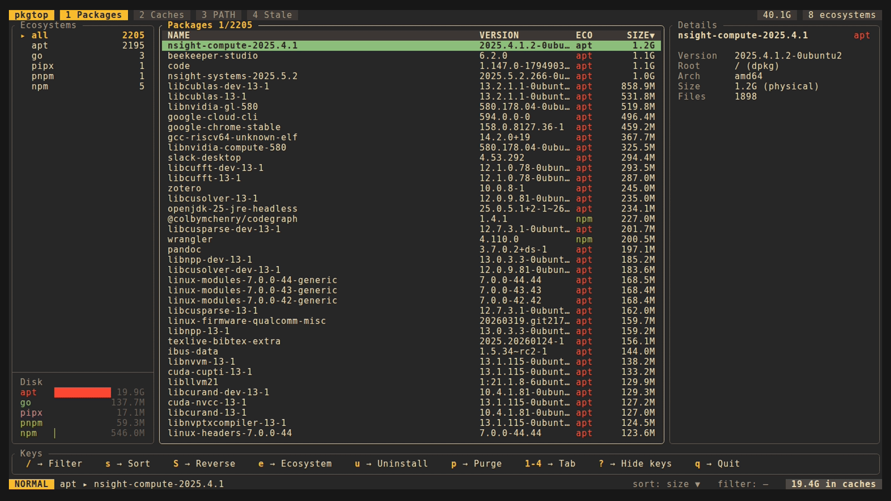

# heft

> Formerly **pkgtop**. Re-run the install command below to switch; `pkgtop` keeps working as a symlink.

`top` for your package managers. One keyboard-driven terminal view of everything installed across apt, pacman, Homebrew, cargo, go, uv/pip and npm/pnpm, with the physical disk usage of each package and cache, when you last used it, and which binary on your `$PATH` actually wins.

heft is read-only. It never runs a package manager just to look. When you uninstall something, it hands over to that ecosystem's own command.



> Status: early. Planned work is in [issues](https://github.com/sinhaparth5/heft/issues).

## Install

Linux (x86_64 or aarch64, any distro; a single static binary):

```sh
curl -fsSL https://raw.githubusercontent.com/sinhaparth5/heft/main/install.sh | sh
```

It installs to `~/.local/bin` (`/usr/local/bin` as root) after checking the sha256. Run the same command again to upgrade. Pick another place with `HEFT_BIN_DIR=/usr/local/bin`, or a specific release with `HEFT_VERSION=v2026.11.1`. You can also download the tarball from [Releases](https://github.com/sinhaparth5/heft/releases) yourself.

- **Windows:** not supported natively. Run the same command inside WSL.
- **macOS:** not yet ([#1](https://github.com/sinhaparth5/heft/issues/1)). Until then, build from source below.

## Build

```sh
cmake -S . -B build -G Ninja && cmake --build build
./build/heft            # TUI (u uninstalls, p purges a cache, t starts/stops a container; always after a confirm)
./build/heft --list --sizes
./build/heft --caches
./build/heft --path        # every $PATH binary: owner, shadowed/shim/broken flags
./build/heft --stale       # packages by bloat score: size x days since last use
./build/heft --outdated    # newer versions: apt/pacman from local indexes; crates.io, PyPI,
                             # npm, Go proxy, Homebrew over the network (opt-in)
./build/heft --updates     # TUI with the same checks in the background
./build/heft --ascii       # TUI drawn with ASCII only (combines with --updates)
```

Releasing: add lines under `[Unreleased]` in `CHANGELOG.md`, commit, then `make tag VERSION=YYYY.MM.PATCH`. It bumps the version, turns `[Unreleased]` into the release notes, tags `vYYYY.MM.PATCH` and pushes; CI builds and publishes the release.

The TUI's dependency, [FTXUI](https://github.com/ArthurSonzogni/FTXUI), is fetched by CMake on first configure.

Reads apt, pacman, Homebrew, cargo, Go, uv tools, pipx, npm and pnpm straight from disk.

Requires a C++23 compiler (GCC 14+ / Clang 18+) and CMake 3.28+.

## License

MIT
